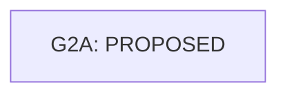

<!-- Generated by scripts/governance/generate-views.mjs; canonical sources are work/items and work/evidence. -->
# Work dependencies (informative)

This projection is non-canonical. G2a is **non-release and not alpha-eligible**.

